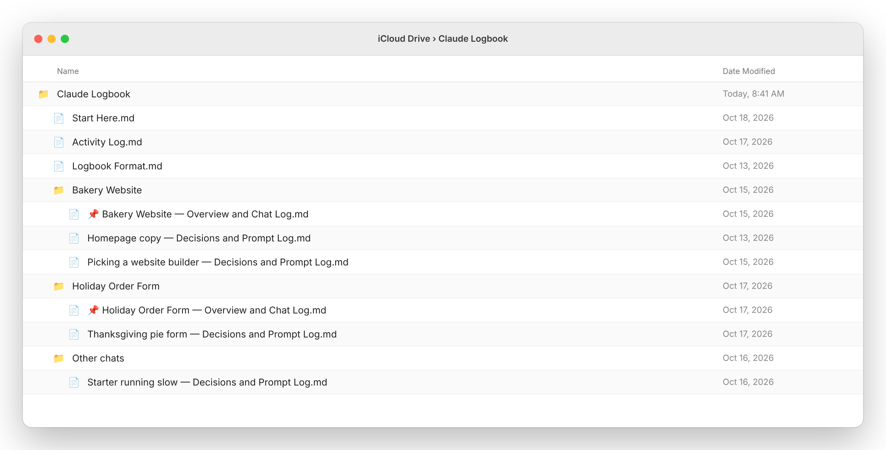
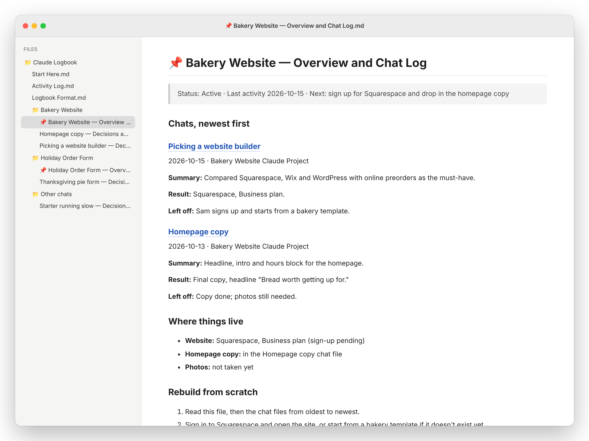
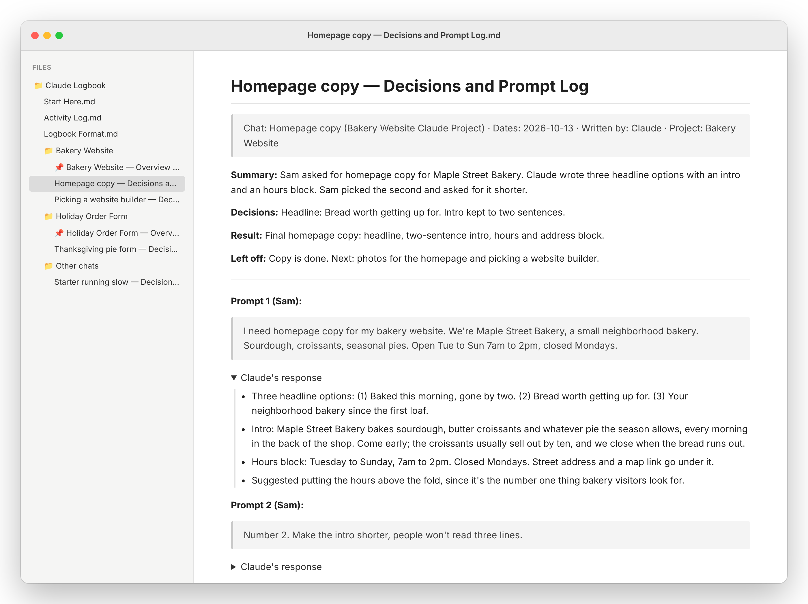
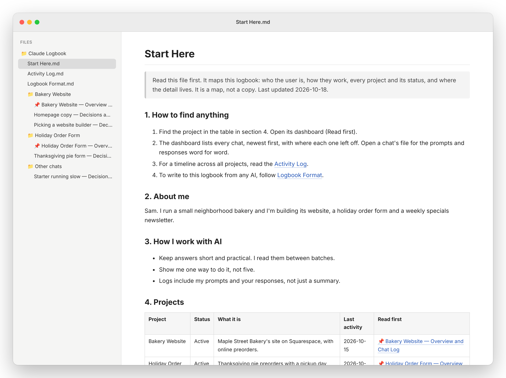
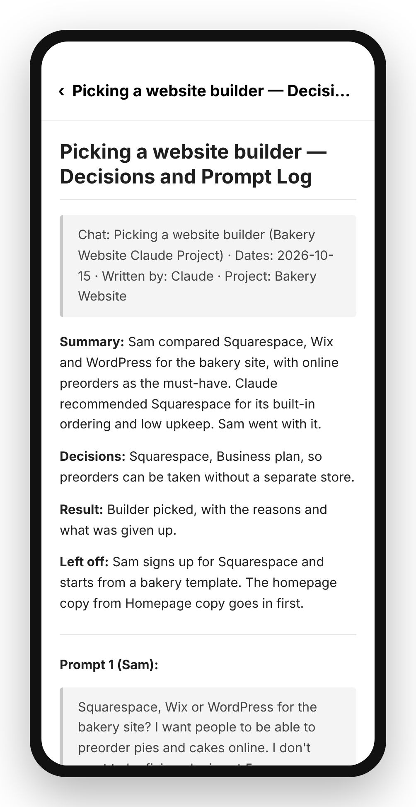

# Folder Logbook for Claude

Folder Logbook for Claude keeps a record of your work with Claude as plain Markdown files in a folder you pick. Every chat worth keeping gets its own file with your prompts word for word and Claude's responses. A dashboard per project says where each chat left off, so a new chat picks up without you re-explaining anything.

No database, no account, no new app. Put the folder in OneDrive, iCloud Drive, Dropbox or Google Drive and the logbook is on your phone too.

I built it because I'm bad at taking notes and worse at reading them. Claude does the writing now.

## What it looks like

These are from a demo logbook for a made-up bakery owner named Sam.

The folder. One file per chat, and the 📌 dashboard sorts to the top of each project:



A project's dashboard. Every chat, newest first, with where each one left off:



One chat's file. Sam's prompt word for word, Claude's response folded under it:



Start Here, the map of the whole logbook:



On the phone, in the OneDrive or Files app:



## What you need

- A Claude plan that supports plugins (Pro, Max, Team or Enterprise)
- The Claude desktop app on the computer that has the folder, or Claude Code
- A folder. Any synced drive works; so does a plain folder on one computer.

The logbook is a few hundred kilobytes of text, so the free tier of any cloud drive is plenty.

## Install

**From GitHub:** open Customize > Plugins > Add > Add marketplace in Claude and enter `Doctype-Noob/folder-logbook-for-claude`. Then add Folder Logbook for Claude from the list.

**In Claude Code:**

```
/plugin install laronge-folder-logbook --marketplace Doctype-Noob/folder-logbook-for-claude
```

## Use it

1. Connect the folder you want the logbook in. In the Claude desktop app that's Add folder in the + menu beside the message box. Pick one inside your synced drive if you want it on your phone.
2. Run **setup** once: type `/` and pick the logbook setup command, or say "set up my logbook". It creates Start Here, the Activity Log and Logbook Format, asks three quick questions, and offers to set up your projects.
3. Paste the always-log line setup gives you into Settings > Profile, in your preferences. Do this one. Without it, Claude only logs when it notices a chat is worth keeping, and it misses some.
4. Work normally. The first time a chat produces ideas, research, a decision or finished work, Claude starts a file for it, asks once what the chat is called in your sidebar, and adds every exchange after that. It ends each reply with one line that starts "Logged to folder:".
5. Done for the day? Say "wrap up". Claude writes the prompt you paste to start the next chat, in the chat and at the end of the chat file.

## Commands

- `/laronge-folder-logbook:setup` sets up the folder, or adopts a logbook you already have.
- `/laronge-folder-logbook:log-session` logs the current chat right now.
- `/laronge-folder-logbook:backfill` logs a project's earlier chats, 3 on the first run and 5 at a time after that. Run it from a chat inside that project's Claude Project, with Search and reference chats turned on.

After setup you don't need any of them.

## Using it with other AI tools

Setup writes **Logbook Format.md** into the folder. It's the full spec for every file and entry. Tell Gemini, ChatGPT or any AI that can read the folder to follow it, and its files will match Claude's. Each chat file says which AI wrote it.

It's also plain Markdown, so the folder opens as an Obsidian vault, or in Typora, VS Code or any text editor.

## What it won't do

- **Delete anything.** Files that should go are moved to a `_to_delete` folder for you to clear.
- **Touch your own files.** It only edits files it created, plus its own entries on dashboards and in Start Here.
- **Keep secrets.** Passwords, API keys and card numbers are written as [redacted].
- **Log from your phone.** Claude can only write to the folder from the computer that has it. On the phone or the web it says it couldn't log, instead of failing quietly. Open the chat later in the desktop app with the folder connected and say "log this".

## Craft user?

The same logbook, written into Craft instead of files: [Craft Logbook for Claude](https://github.com/Doctype-Noob/craft-logbook-for-claude).

## License

MIT. By Josh Laronge, [laronge.com](https://laronge.com).
